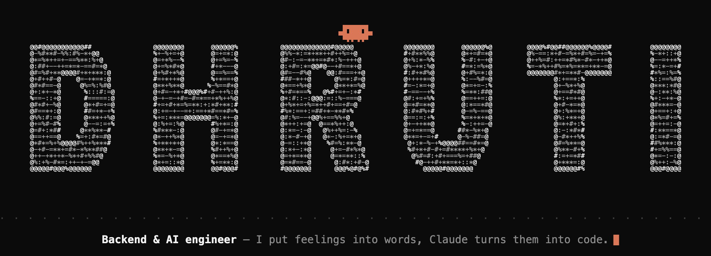
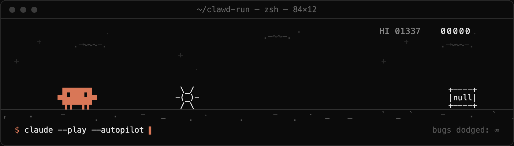

<p align="center">
  
</p>

### `$ whoami`

```text
┌──────────────────────────────────────────────────────────────────┐
│  role      : Software Engineer · Backend & AI                    │
│  exp       : 2 years building backend systems + AI products      │
│  alma mater: NIT Rourkela · B.Tech, Mining Engineering           │
│  off-hours : building and flying drones                          │
│  status    : ● online · shipping                                 │
└──────────────────────────────────────────────────────────────────┘
```

### `$ tree ~/stack`

```text
~/stack
├── languages/   go · python · typescript · javascript
├── backend/     echo v5 · hono · express.js · fastapi
├── frontend/    next.js · react · tailwind css
├── data/        postgresql · mongodb · redis · neo4j · qdrant
└── cloud/       aws · gcp · docker · ci/cd · railway
```

### `$ cat about.txt`

```text
I studied mining engineering, but somewhere along the way software
became my real calling. I like working close to the systems layer:
designing APIs, distributed backend services, data pipelines, and
AI-powered applications, built from the ground up.

Away from the keyboard I'm deep into building lego sets and watching movies.
It keeps me curious about hardware, systems, and everything in
between.

I write, build, experiment, and share most of the journey on X.
```

### `$ ping dhruti`

```text
I'm most active on X, so that's the best place to reach me.
Always up for talking backend systems, AI products,
distributed systems, or drones.
```

[`[ x ] @D_SwainX`](https://twitter.com/D_SwainX) &nbsp;
[`[ gh ] swaindhruti`](https://github.com/swaindhruti) &nbsp;
[`[ www ] dhrutinandan.space`](https://dhrutinandan.space)

### `$ claude --play`

<p align="center">
  
</p>

<sub><code>// eof · exit 0</code></sub>
